# Database design

PostgreSQL schema for Sajsub Tech, defined in [backend/prisma/schema.prisma](../backend/prisma/schema.prisma). GitHub and VS Code (with a Mermaid extension) render the diagram below.

## ER diagram

```mermaid
erDiagram
    User ||--o{ UserSession : "has"
    User ||--o{ PasswordResetToken : "requests"
    User |o--o{ LoginLog : "logged as"
    User ||--o{ Address : "saves"
    User ||--o| Cart : "owns"
    User ||--o| Wishlist : "owns"
    User ||--o{ Order : "places"
    User |o--o{ AIConversation : "chats in"
    User |o--o{ AuditLog : "acts in"
    User |o--o{ InventoryTransaction : "performs"

    Category |o--o{ Category : "parent of"
    Category ||--o{ Product : "groups"
    Brand ||--o{ Product : "makes"
    Product ||--o{ ProductImage : "shows"
    Product ||--o{ ProductSpecification : "describes"
    Product ||--o{ InventoryTransaction : "tracked by"

    Cart ||--o{ CartItem : "contains"
    Product ||--o{ CartItem : "added as"
    Wishlist ||--o{ WishlistItem : "contains"
    Product ||--o{ WishlistItem : "saved as"

    Order ||--|{ OrderItem : "contains"
    Product ||--o{ OrderItem : "sold as"
    Order ||--o{ Payment : "paid by"
    Order |o--o{ InventoryTransaction : "causes"

    AIConversation ||--o{ AIMessage : "contains"

    User {
        uuid id PK
        string email UK
        string passwordHash
        enum role "ADMIN or CUSTOMER"
        enum status
        timestamp deletedAt
    }
    UserSession {
        uuid id PK
        uuid userId FK
        string refreshTokenHash UK
        timestamp expiresAt
        timestamp revokedAt
    }
    PasswordResetToken {
        uuid id PK
        uuid userId FK
        string tokenHash UK
        timestamp expiresAt
        timestamp usedAt
    }
    LoginLog {
        uuid id PK
        uuid userId FK "nullable"
        string email
        boolean success
    }
    Category {
        uuid id PK
        uuid parentId FK "nullable"
        string slug UK
        boolean showInMenu
        boolean isFeatured
    }
    Brand {
        uuid id PK
        string name UK
        string slug UK
    }
    Product {
        uuid id PK
        string name
        string slug UK
        string sku UK
        decimal price
        decimal discountPrice "nullable"
        uuid categoryId FK
        uuid brandId FK
        int stockQuantity "never below 0"
        enum status
        boolean isFeatured
    }
    ProductImage {
        uuid id PK
        uuid productId FK
        string url
        boolean isPrimary
    }
    ProductSpecification {
        uuid id PK
        uuid productId FK
        string name
        string value
    }
    InventoryTransaction {
        uuid id PK
        uuid productId FK
        uuid orderId FK "nullable"
        uuid performedById FK "nullable"
        enum type
        int quantityChange
        int stockBefore
        int stockAfter
    }
    Address {
        uuid id PK
        uuid userId FK
        boolean isDefault
    }
    Cart {
        uuid id PK
        uuid userId FK,UK
    }
    CartItem {
        uuid id PK
        uuid cartId FK
        uuid productId FK
        int quantity
    }
    Wishlist {
        uuid id PK
        uuid userId FK,UK
    }
    WishlistItem {
        uuid id PK
        uuid wishlistId FK
        uuid productId FK
    }
    Order {
        uuid id PK
        string orderNumber UK
        uuid userId FK
        enum status
        enum paymentStatus
        decimal totalAmount
        json shippingAddress
    }
    OrderItem {
        uuid id PK
        uuid orderId FK
        uuid productId FK
        string productName "snapshot"
        string productSku "snapshot"
        decimal unitPrice "snapshot"
        int quantity
        decimal lineTotal
    }
    Payment {
        uuid id PK
        uuid orderId FK
        enum method
        enum status
        string providerTransactionId UK
        decimal amount
    }
    AIConversation {
        uuid id PK
        uuid userId FK "nullable"
        string guestKey "nullable"
    }
    AIMessage {
        uuid id PK
        uuid conversationId FK
        enum role
        text content
        json toolCalls
    }
    AuditLog {
        uuid id PK
        uuid actorId FK "nullable"
        string action
        string entityType
        json changes
    }
    SiteSetting {
        uuid id PK
        string key UK
        json value
        boolean isPublic
    }
    Banner {
        uuid id PK
        string title
        enum placement
        boolean isActive
    }
```

`SiteSetting` and `Banner` stand alone, with no foreign keys.

## Relationships

- **Accounts:** a user has many sessions, login records, addresses and orders, and at most one cart and one wishlist. There is one `User` table, and `role` separates `ADMIN` from `CUSTOMER`. The column defaults to `CUSTOMER`, and admins are only created by the setup script.
- **Catalog:** every product belongs to one category and one brand, and has many images and specifications. Categories can nest through `parentId`.
- **Inventory:** `Product.stockQuantity` is the current stock. Each change also writes an `InventoryTransaction` recording the before and after values.
- **Cart and wishlist:** each item links one product to one cart or wishlist, and a product can appear only once in each.
- **Orders:** an order has at least one item and any number of payment attempts. An item keeps a copy of the product's name, SKU and price, so later catalog edits don't change past orders. The shipping address is copied onto the order for the same reason.
- **AI:** a conversation belongs to a user or to a guest key, and holds ordered messages, including tool calls.
- **Administration:** `AuditLog` records admin actions. `SiteSetting` and `Banner` hold editable site content.

## Rules enforced by the database

These still hold if application code has a bug. Check constraints and partial indexes aren't expressible in the Prisma schema, so they're hand-written in the initial migration.

| Rule | How |
| --- | --- |
| Stock can't go negative | `CHECK (stockQuantity >= 0)`, also on `stockAfter` |
| Ledger arithmetic is correct | `CHECK (stockAfter = stockBefore + quantityChange)`, and the change can't be 0 |
| No duplicate cart or wishlist items | `UNIQUE (cartId, productId)`, `UNIQUE (wishlistId, productId)` |
| Discount is below the price | `CHECK (discountPrice IS NULL OR (discountPrice >= 0 AND discountPrice < price))` |
| Quantities are positive | `CHECK (quantity > 0)` on cart and order items |
| Money can't be negative | `CHECK` on prices, order amounts and payments |
| Ratings are valid | `CHECK (ratingAverage BETWEEN 0 AND 5)`, `CHECK (ratingCount >= 0)` |
| Emails are stored in lowercase | `CHECK (email = lower(email))` |
| One default address per user | Partial unique index on `userId` where `isDefault` |
| One primary image per product | Partial unique index on `productId` where `isPrimary` |

Identifiers are UUIDs generated by PostgreSQL. Money uses `DECIMAL(12,2)`, and timestamps include a time zone.

## Deletion and archival policy

| Data | Policy | When a parent is deleted |
| --- | --- | --- |
| User | Archive: set `status = DELETED` and `deletedAt`. Never hard-delete a user who has orders | Orders block deletion |
| Session, PasswordResetToken, Address, Cart, Wishlist | Hard-delete | Removed with the user |
| LoginLog, AuditLog | Keep | `userId` / `actorId` becomes null. The login email is kept |
| AIConversation | Keep | `userId` becomes null. Messages are removed only with the conversation |
| Product | Hard-delete with no history. Otherwise archive: set `status = ARCHIVED` and `archivedAt` | Order items and inventory history block deletion |
| ProductImage, ProductSpecification | Hard-delete | Removed with the product |
| CartItem, WishlistItem | Hard-delete | Removed with the cart, wishlist or product |
| Category, Brand | Hard-delete when unused. Otherwise archive: set `isActive = false` | Products and child categories block deletion |
| Order, OrderItem, Payment | Never delete. Use `CANCELLED` or `REFUNDED` | Payments and inventory history block order deletion |
| InventoryTransaction | Never delete or edit. Correct with a new `ADJUSTMENT` | Blocks product deletion |
| SiteSetting, Banner | Hard-delete, or set a banner's `isActive = false` | - |

## Transactions

[inventory.service.js](../backend/src/services/inventory.service.js) updates stock and writes its ledger entry in one transaction. The update only succeeds if enough stock remains, so simultaneous orders can't oversell. Checkout in a later phase must create the order, its items, the stock changes and the cart clearing in one transaction, by passing its transaction client to `adjustStock`.

## Handling blocked deletes

PostgreSQL 18 reports a blocked `RESTRICT` delete with error code `23001`, and Prisma 6 passes it through without its usual `P2003` code. API code should archive these records, as the policy above requires, and shouldn't rely on catching `P2003`.

## Known gap

The homepage design shows star ratings and review counts, but the required model list has no `Review` table. `Product` stores `ratingAverage` and `ratingCount` for the cards. Customer reviews need their own model when that feature is built.
